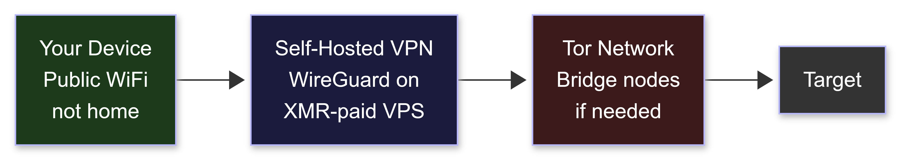
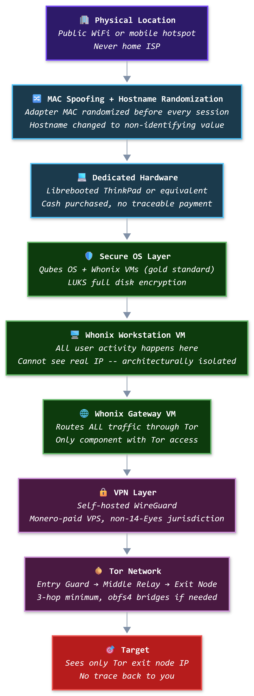
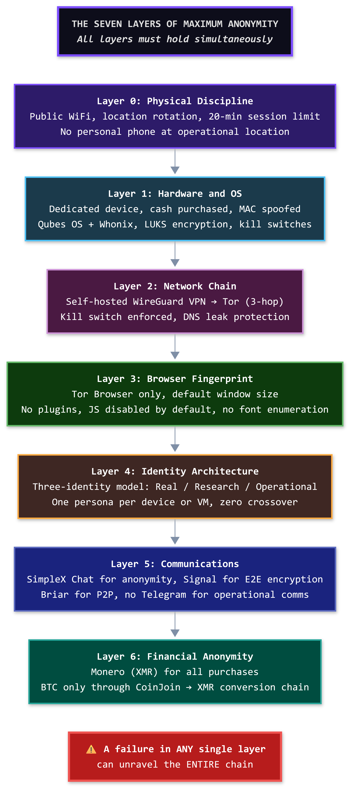
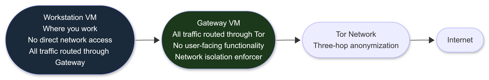
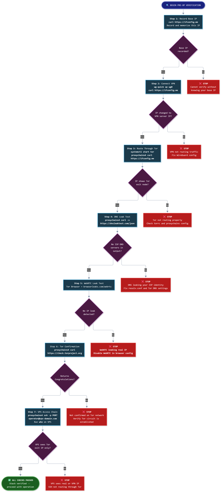

# Maximum Anonymity Workflow

**The Quick-Reference Anonymity Architecture Guide - 2027 Edition**

**Author:** Sagar Biswas ([@SagarBiswas-MultiHAT](https://github.com/SagarBiswas-MultiHAT))<br/>
**Canonical Repository:** [The BlackHAT Roadmap](https://github.com/SagarBiswas-MultiHAT/The-BlackHAT-roadmap)<br/>
**License:** [CC BY-SA 4.0](https://github.com/SagarBiswas-MultiHAT/The-BlackHAT-roadmap/blob/main/LICENSE-DOCS)<br/>
**Version:** v1.0.0 · 2027 Edition

<div align="right">

**The chain is only as strong as the weakest layer. Most operators only build one layer.**

</div>

> 📚 **Companion Roadmap Documents:**
> * **[The BlackHAT Roadmap (Canonical Repo)](https://github.com/SagarBiswas-MultiHAT/The-BlackHAT-roadmap)**: Master curriculum, issue discussions, and live roadmap updates.
> * **[Phase -1: OPSEC and Infrastructure](../phases/PHASE_-1.md)**: The complete OPSEC foundation -- every technical detail behind the anonymity stack in this document.
> * **[BlackHat Long-Term Survival Tactics](BlackHat_Long-Term_Survival_Tactics.md)**: The authoritative operational security, physical tradecraft, and digital persona architecture manual.
> * **[Philosophy: The BlackHat Mindset](../field-guides/Philosophy_The_BlackHat_Mindset.md)**: Cognitive doctrine, adversarial assumption hunting, and primitive thinking mental models.
> * **[FAQ](../field-guides/FAQ.md)**: Comprehensive operational and career transitions FAQ.
> * **[Lab Setup Guide](../field-guides/Lab_Setup_Guide.md)**: Multi-tier hardware specifications and isolated enterprise/kernel lab blueprints.

> **Recommended Curated Roadmap Resources:**
> * **[Awesome Cybersecurity Paths](https://github.com/SagarBiswas-MultiHAT/awesome-cybersecurity-paths)**: Curated pathways for penetration testers, red teamers, blue teamers, and security researchers.
> * **[Penetration Testing Roadmap](https://github.com/SagarBiswas-MultiHAT/penetration-testing-roadmap)**: Practical assessment workflows, tooling matrices, and engagement methodologies.
> * **[Awesome Cybersecurity Books](https://github.com/SagarBiswas-MultiHAT/awesome-cybersecurity-books)**: Curated offensive security and low-level systems literature.

---

> *"Most guides explain how to install Tor. This document explains why Tor alone is not enough, what the complete chain looks like, and what breaks when you skip a layer."*

---

## WHY THIS DOCUMENT EXISTS

[Phase -1](../phases/PHASE_-1.md) is the definitive, exhaustive OPSEC reference -- over 4,000 lines covering every facet of anonymity, infrastructure, forensics, and operational discipline. [BlackHat Long-Term Survival Tactics](BlackHat_Long-Term_Survival_Tactics.md) extends that into 3,000+ lines of advanced tradecraft.

Both are essential reading. Both are dense.

This document exists for a different purpose: to give beginners and intermediate operators a **single, clear, end-to-end picture** of how the anonymity architecture actually works -- the full chain from your local machine to the target, what each layer does, what each layer does not do, and how they stack together.

Think of this as the architectural blueprint. Phase -1 and the Survival Tactics manual are the complete construction specifications. Read the blueprint first. Then build from the specifications.

**What this document covers:**
1. The complete traffic chain (Local Machine to Target)
2. What every adversary sees at every hop
3. The seven operational layers beyond just the network chain
4. How to calibrate your stack to your actual threat model
5. The verification checklist to confirm it all works

**What this document does not cover:**
- Step-by-step tool installation (see [Phase -1, Sections 8-9](../phases/PHASE_-1.md))
- Deep VPS hardening (see [Phase -1, Section 8](../phases/PHASE_-1.md))
- Cryptocurrency acquisition chains (see [Phase -1, Section 11](../phases/PHASE_-1.md))
- Communication platform security comparison (see [Phase -1, Section 6](../phases/PHASE_-1.md))
- Physical counter-surveillance (see [Survival Tactics, Sections 6-7](BlackHat_Long-Term_Survival_Tactics.md))

---

## TABLE OF CONTENTS

1. [The Core Chain: Local Machine to Target](#1-the-core-chain-local-machine-to-target)
2. [What Each Adversary Sees](#2-what-each-adversary-sees)
3. [The OPSEC Failure Pyramid: Why the Chain Is Not Enough](#3-the-opsec-failure-pyramid-why-the-chain-is-not-enough)
4. [The Seven Layers of Maximum Anonymity](#4-the-seven-layers-of-maximum-anonymity)
5. [The Three-Identity Model](#5-the-three-identity-model)
6. [Whonix: The Architectural Leak-Proof Guarantee](#6-whonix-the-architectural-leak-proof-guarantee)
7. [Threat Model Tiers: Calibrate Your Stack](#7-threat-model-tiers-calibrate-your-stack)
8. [Stack Verification Checklist](#8-stack-verification-checklist)
9. [Common Mistakes That Break the Chain](#9-common-mistakes-that-break-the-chain)
10. [Where to Go Next](#10-where-to-go-next)

---

## 1. THE CORE CHAIN: LOCAL MACHINE TO TARGET

The recommended configuration for maximum anonymity (VPN-to-Tor):

```
Your machine --> VPN (self-hosted) --> Tor network --> Destination
```

The Layering Model from the [Survival Tactics manual (Section 3.1)](BlackHat_Long-Term_Survival_Tactics.md) defines the operational chain:

<div align="center">
<table><tr><td>



</td></tr></table>
</div>

The expanded operational chain, with physical discipline included:

```
Physical Location (public WiFi or mobile hotspot -- never home ISP)
  --> MAC-spoofed adapter + randomized hostname
    --> Dedicated hardware (Qubes OS + Whonix VMs)
      --> VPN-1 (WireGuard on Monero-paid VPS, non-14-Eyes jurisdiction)
        --> Tor with obfs4 bridges (Entry --> Middle --> Exit)
          --> Target
```

<div align="center">
<table><tr><td>



</td></tr></table>
</div>

When the target blocks Tor exit nodes, a second configuration applies (Tor-to-VPN):

```
Your machine --> Tor --> VPN-2 (different provider, different jurisdiction) --> Target
```

This variant hides the Tor exit IP from the target. The tradeoff: the VPN-2 provider can see the content of your traffic (though not your real IP, since it arrives via Tor).

**The critical rule on VPN selection:**

Do NOT use commercial VPN chains (ExpressVPN, NordVPN, or similar). The [Survival Tactics manual](BlackHat_Long-Term_Survival_Tactics.md) documents why:
- Multiple cooperation cases with law enforcement (2017-2025)
- Metadata logging despite "no-log" marketing claims (confirmed in court cases)
- Many operate from Five-Eyes-adjacent jurisdictions
- Paying with credit card = your identity is their first record

The correct approach: self-hosted WireGuard on an anonymous VPS.

```
VPS requirements:
- Provider accepts Monero (XMR) -- no KYC required
- Recommended: Njalla, 1984 Hosting, FlokiNET, Alexhost, SporeStack
- Jurisdiction priority: Iceland > Moldova > Romania > Netherlands
- Avoid: UK, US, Australia, Canada, NZ (Five-Eyes)
- Avoid: Germany (strong LE cooperation), France (ANSSI/DGSI active)
- All management access via Tor only -- VPS never sees your real IP
- Zero logging enforced (cron job wipes logs every 30 minutes)
```

> **Source:** [Phase -1, Section 9](../phases/PHASE_-1.md) · [Survival Tactics, Section 3.2](BlackHat_Long-Term_Survival_Tactics.md)

---

## 2. WHAT EACH ADVERSARY SEES

Understanding what each participant in the chain can and cannot see is the foundation of evaluating whether the chain actually works.

<div align="center">
<table><tr><td>


</td></tr></table>
</div>

| Adversary | What They See | What They Cannot See |
|---|---|---|
| **Your ISP** | Encrypted traffic to VPN server | That you use Tor; your destination; your content |
| **VPN Provider** | Your IP + Tor traffic | Your final destination (if no-log policy holds: nothing retained) |
| **Tor Entry Node** | VPN IP (not your real IP) | Your destination; your content |
| **Tor Exit Node** | Traffic to destination | Your real IP; your VPN IP |
| **Destination** | Tor exit node IP only | Your real IP; any trace back to you |

**Why VPN before Tor (and not just Tor alone):**

1. Hides Tor usage from your ISP. In many countries and corporate environments, Tor usage itself is flagged as suspicious. The VPN makes your traffic look like ordinary encrypted VPN traffic.
2. Hides your real IP from the Tor entry node. Without the VPN layer, the Tor entry guard knows your real IP address.
3. The VPN provider cannot see your final destination because your traffic enters the Tor network after the VPN.
4. No single point in the chain knows both who you are and where you are going.

> **Source:** [Phase -1, Section 9.4, Lines 1218-1243](../phases/PHASE_-1.md)

---

## 3. THE OPSEC FAILURE PYRAMID: WHY THE CHAIN IS NOT ENOUGH

This is the most important concept in this document.

The traffic chain (VPN --> Tor --> Target) is the network layer. **Network anonymity is only the middle layer.** The layers that actually lead to arrests are above and below it.

<div align="center">
<table><tr><td>


</td></tr></table>
</div>

| Layer | What It Covers | How Often It Causes Arrests |
|---|---|---|
| **Human Layer** | Reused usernames, bragging, trust failures, communication mistakes, social engineering | Top cause (~40% of arrests from bragging alone) |
| **Network Layer** | VPN, Tor, anonymized infrastructure, encrypted communications | ~20% of arrests from technical mistakes |
| **Physical Layer** | Facial recognition, ANPR, device forensics, workspace surveillance, hardware trails | Often overlooked; enables parallel construction |
| **Forensic Layer** | Log artifacts on your own machine, RAM forensics, deleted file recovery, metadata in files | Almost never taught; your own device becomes the strongest evidence against you |

From [Phase -1](../phases/PHASE_-1.md):

> *"Most operators think about network anonymity first. Network anonymity is the middle layer. The layers that actually kill careers are above and below it."*

The network chain described in Section 1 is necessary. It is not sufficient. The remaining sections of this document cover the layers that make the chain actually hold.

---

## 4. THE SEVEN LAYERS OF MAXIMUM ANONYMITY

Maximum anonymity requires all seven layers to hold simultaneously. A failure in any single layer can unravel the entire chain.

<div align="center">
<table><tr><td>



</td></tr></table>
</div>

---

### Layer 0: Physical Discipline

Your physical presence must not correlate with your digital activity.

| Requirement | Detail |
|---|---|
| **Network source** | Public WiFi or mobile hotspot. Never your home ISP for operational activity. |
| **Location rotation** | Never use the same public WiFi location twice consecutively. |
| **Session time limit** | 20-25 minutes maximum per physical location. |
| **Personal phone** | Leave at home or in a Faraday bag. Never co-locate personal and operational devices. |
| **CCTV awareness** | Face away from cameras. Wear non-distinctive clothing. No identifiable accessories. |

> **Deep dive:** [Survival Tactics, Sections 6-7](BlackHat_Long-Term_Survival_Tactics.md)

---

### Layer 1: Hardware and Operating System

Your device must not betray you, even if seized.

| Requirement | Detail |
|---|---|
| **Dedicated device** | Separate laptop per persona (ideal). At minimum, strict VM compartmentalization. |
| **Recommended hardware** | Librebooted ThinkPad X230/T430 (budget, proven) or Coreboot ThinkPad T480 (modern balance). |
| **Purchase method** | Cash only, physical store, no traceable payment. |
| **MAC spoofing** | Randomize MAC address before every session. |
| **Hostname** | Randomize before every session. |
| **Webcam / Mic / Bluetooth** | Physically disabled or hardware kill-switched. |
| **Disk encryption** | LUKS full disk encryption. Non-negotiable. |
| **Serial numbers** | Remove all stickers. Replace via Coreboot if possible. |

**OS selection by skill level:**

```
Beginner:      Tails OS (USB boot)
               - Amnesiac: wipes everything on shutdown
               - Tor by default: all traffic routed through Tor automatically
               - Zero trace on host hardware
               - Best for: single operations, maximum leave-no-trace sessions

Intermediate:  Qubes OS
               - Compartmentalization built into the OS architecture
               - Different VM per persona / task
               - dom0 (management domain) has no network access
               - Best for: multi-persona operations, daily research

Advanced:      Qubes OS + Whonix VMs (gold standard, 2027)
               - Qubes handles compartmentalization
               - Whonix Gateway VM forces ALL traffic through Tor
               - Even if Workstation VM is compromised, real IP cannot leak
               - Best for: sustained high-security operations
```

> **Deep dive:** [Phase -1, Section 13](../phases/PHASE_-1.md) · [Survival Tactics, Section 2](BlackHat_Long-Term_Survival_Tactics.md)

---

### Layer 2: Network Chain

This is the traffic chain from Section 1 of this document.

```
Your machine --> VPN-1 (self-hosted WireGuard) --> Tor (3-hop) --> Target
```

Key implementation details:

```
VPN:
- Self-hosted WireGuard on anonymous VPS (Monero-paid, non-14-Eyes)
- Kill switch mandatory (PostUp/PreDown iptables rules)
- If VPN drops, ALL traffic must stop -- not fall back to your real IP

Tor:
- Use obfs4 bridges if Tor usage is suspicious in your jurisdiction
- Exclude Five-Eyes exit nodes in torrc:
    ExcludeExitNodes {US},{GB},{AU},{CA},{NZ}
    StrictNodes 1
- Enable stream isolation:
    IsolateDestAddr 1
    IsolateDestPort 1

Leak prevention:
- DNS: must resolve through Tor or VPN only
- WebRTC: disabled in all browsers (media.peerconnection.enabled = false)
- WebGPU: disabled in all browsers (dom.webgpu.enabled = false)
- Test: dnsleaktest.com, browserleaks.com, ipleak.net (all via Tor Browser)
```

> **Deep dive:** [Phase -1, Section 9](../phases/PHASE_-1.md) · [Survival Tactics, Section 3](BlackHat_Long-Term_Survival_Tactics.md)

---

### Layer 3: Whonix (Leak-Proof Enforcement)

Whonix provides an architectural guarantee that goes beyond configuration. See Section 6 of this document for the full explanation.

---

### Layer 4: Identity Compartmentalization

Three identities. Absolute separation between each. See Section 5 of this document for the full model.

---

### Layer 5: Financial OPSEC

Your payment trail must not lead back to you.

```
Rules:
- All research-related purchases: Monero (XMR) only
- Acquisition chain: Fiat --> Bitcoin (P2P or ATM) --> Atomic swap to Monero
- Never use personal credit cards, bank accounts, or KYC exchanges
- Never reuse wallet addresses
- One wallet per persona
- Recommended wallet: Feather Wallet (https://featherwallet.org)
- Exchanges: Haveno (Monero-native DEX), Bisq (Bitcoin/XMR DEX)
```

> **Deep dive:** [Phase -1, Section 11](../phases/PHASE_-1.md) · [Survival Tactics, Section 5](BlackHat_Long-Term_Survival_Tactics.md)

---

### Layer 6: Communications

Your communication channel is the number one arrest vector. More operators have been caught through communication records than through any technical failure.

```
For maximum anonymity (2027):
- SimpleX Chat: no user IDs, no phone numbers, no usernames, fully decentralized
  Servers cannot correlate senders to receivers even in metadata
  https://simplex.chat

Acceptable (gold standard E2E encryption, but weaker on anonymity):
- Signal: Signal Protocol (the strongest E2E encryption protocol available)
  Sealed sender, disappearing messages (1 hour max for operational comms)
  Weakness: requires phone number (use prepaid SIM via VoIP/JMP.chat over Tor)
  Weakness: Signal servers see who you communicate with (metadata)
  Verdict: acceptable for comms not requiring full anonymity;
           SimpleX preferred for anonymity-critical comms

Decentralized fallback:
- Session: no phone number required, Lokinet overlay
- Briar: peer-to-peer, Tor-routed, works offline via Bluetooth/WiFi mesh

HARD PROHIBITION (2027):
- Telegram: cooperates with LE since August 2024 (Durov arrest)
  All standard/group chats stored in readable form on Telegram servers
- Discord: extensive logs, very cooperative with LE
- WhatsApp: E2E content but extensive metadata logging
- SMS: no encryption at carrier level, extensive logs
```

> **Deep dive:** [Phase -1, Section 6](../phases/PHASE_-1.md) · [Survival Tactics, Section 4](BlackHat_Long-Term_Survival_Tactics.md)

---

### Layer 7: Behavioral Discipline

The most difficult layer. Technical controls can be automated. Behavior must be maintained by willpower.

```
Time-zone masking:
- Post and operate at randomized times, not your real timezone
- A consistent posting pattern reveals your geographic region

Linguistic OPSEC:
- Avoid distinctive writing patterns (stylometry analysis can identify authors)
- Vary sentence length, vocabulary, punctuation habits between personas
- Use different personas for different contexts -- never mix styles

Metadata scrubbing:
- ExifTool for images (GPS coordinates, camera model, timestamps)
- mat2 for documents (author name, software version, revision history)
- Strip ALL metadata before ANY upload, every time

Session hygiene:
- Run session-start script before every operation:
  1. Spoof MAC address (both interfaces)
  2. Randomize hostname
  3. Set privacy-respecting DNS
  4. Flush DNS cache
  5. Verify IP (confirm VPN + Tor working)
  6. Verify no DNS leaks
  7. Verify no WebRTC leaks
```

> **Deep dive:** [Phase -1, Sections 12, 15-16](../phases/PHASE_-1.md) · [Survival Tactics, Section 3.5](BlackHat_Long-Term_Survival_Tactics.md)

---

## 5. THE THREE-IDENTITY MODEL

Maximum anonymity requires absolute separation between three identities. No shared device, IP, email, username, or account between any of them.

<div align="center">
<table><tr><td>


</td></tr></table>
</div>

| Identity | Purpose | Infrastructure | Rules |
|---|---|---|---|
| **Personal** | Real name, real devices, real accounts. Personal email, banking, social media. | Your normal devices and network. | Never touches research or operations. Ever. |
| **Research** | Pseudonym, throwaway email over Tor. CTFs, GitHub security repos, bug bounty, forums, conference registrations. | Dedicated research device or VM. VPN + Tor. | Never crosses into operational activity. |
| **Operational** | Fresh infrastructure per operation. No reuse of IPs, domains, or usernames. Destroyed completely after each operation. | Disposable VMs (Tails or Qubes DispVM). Entirely fresh infrastructure. | No crossover with research identity. No crossover with personal identity. Burned after use. |

The most common mistake beginners make: using their research identity for operational activity. One account, one email, one GitHub handle linked across both contexts creates a chain an investigator can follow from one to the other.

> **Deep dive:** [Phase -1, Section 12](../phases/PHASE_-1.md) · [Survival Tactics, Section 1](BlackHat_Long-Term_Survival_Tactics.md)

---

## 6. WHONIX: THE ARCHITECTURAL LEAK-PROOF GUARANTEE

Why does the roadmap recommend Whonix in addition to the VPN + Tor chain? Because Whonix provides something configuration cannot: an architectural guarantee against IP leaks.

<div align="center">
<table><tr><td>



</td></tr></table>
</div>

Whonix is a two-VM system:

| Component | Role | Network Access |
|---|---|---|
| **Workstation VM** | Where you do all your work. | No direct network access whatsoever. All traffic routed through Gateway. |
| **Gateway VM** | Routes all traffic through Tor. Network isolation enforcer. | NAT to real internet (Adapter 1) + Internal Network to Workstation (Adapter 2). |

**Why this matters:**

Even if malware fully compromises the Workstation VM, it cannot discover your real IP address. The Workstation has no network interface to the real internet. It physically cannot reach the outside world except through the Gateway's Tor circuit. This is not a configuration that can be bypassed by software -- it is an architectural boundary enforced by the hypervisor.

Compare this to just running Tor Browser on your host OS: a single misconfigured application, a WebRTC leak, or a DNS query outside the Tor tunnel reveals your real IP. Whonix eliminates that entire class of failure.

```
QubesOS integration (gold standard):
- sys-whonix qube acts as the Tor gateway
- Research AppVM routes all traffic through sys-whonix:
    qvm-prefs ResearchVM netvm sys-whonix
- dom0 (management domain) has no network access at all
- Disposable VMs for one-shot tasks auto-destroy on close
```

> **Deep dive:** [Phase -1, Section 13.3](../phases/PHASE_-1.md)

---

## 7. THREAT MODEL TIERS: CALIBRATE YOUR STACK

Not every scenario requires the full stack. Match your adversary to your posture. Under-preparing is dangerous. Over-preparing creates friction you will skip under pressure.

The following tiers synthesize the adversary calibration guidance from [Phase -1, Section 5](../phases/PHASE_-1.md) and the [Survival Tactics Threat Modeling Framework](BlackHat_Long-Term_Survival_Tactics.md) into a graduated defense model:

| Tier | Adversary | Required Anonymity Posture |
|---|---|---|
| **1** | Script kiddies, casual doxxers, platform abuse teams | Basic VPN, separate research accounts, no personal info in research profiles |
| **2** | Corporate security teams (SOC, IR), local law enforcement | Full VPN --> Tor chain, Whonix, Monero for purchases, separate devices, encrypted comms |
| **3** | National intelligence (Five Eyes, equivalent agencies) | All of Tier 2 + physical location discipline, Qubes OS, hardware isolation, burner devices, counter-OSINT audit |
| **4** | State-level persistent adversary (APT-level counter-operations) | All of Tier 3 + Faraday discipline, dead drops, air-gapped systems, multi-country infrastructure rotation, exit strategy |

**The most important calibration advice from [Phase -1](../phases/PHASE_-1.md):**

> *"Every layer of OPSEC adds friction. Tor is slow. Separate devices are inconvenient. Monero transactions take time. The friction you are not willing to accept will be the layer you skip under pressure. Be honest about your limits and design your OPSEC around them. An imperfect system you use consistently beats a perfect system you abandon when inconvenient."*

Most security researchers' realistic adversary: **platform abuse teams** and **corporate security teams**. Not NSA. Calibrating to the right adversary determines what protection you actually need. Paranoia about NSA-level adversaries when you face Tier 1 threats wastes time and creates friction that leads to shortcuts.

> **Deep dive:** [Phase -1, Section 5](../phases/PHASE_-1.md) · [Survival Tactics, Threat Modeling Framework](BlackHat_Long-Term_Survival_Tactics.md)

---

## 8. STACK VERIFICATION CHECKLIST

Before any operational session, verify the entire stack end-to-end. Do not assume it works because it worked last time.

<div align="center">
<table><tr><td>



</td></tr></table>
</div>

```bash
# Step 1: Record your base IP (this must NEVER be exposed during operations)
curl https://ifconfig.me
# Record this number. Memorize what it starts with.

# Step 2: Connect VPN. Verify IP changes.
wg-quick up wg0
curl https://ifconfig.me
# Must show VPN server IP, NOT your real IP

# Step 3: Route through Tor. Verify.
systemctl start tor
proxychains4 curl https://ifconfig.me
# Must show a Tor exit node IP (different from VPN IP)

# Step 4: DNS leak test through Tor
proxychains4 curl -s https://dnsleaktest.com/json | python3 -m json.tool
# No ISP DNS servers should appear in the output

# Step 5: WebRTC leak test (browser-based)
# Open Tor Browser --> visit https://browserleaks.com/webrtc
# Must show no IP leak

# Step 6: Full Tor confirmation
proxychains4 curl https://check.torproject.org | grep Congratulations
# Must return: "Congratulations. This browser is configured to use Tor."

# Step 7: VPS access chain verification
proxychains4 ssh -p YOUR_SSH_PORT operator@your-vps-domain.com
# From the VPS, run: who
# Must show Tor exit node IP as the connecting address, not your real IP
```

**If any step fails, do not proceed. Fix the leak first.**

> **Source:** [Phase -1, Section 9.7](../phases/PHASE_-1.md)

---

## 9. COMMON MISTAKES THAT BREAK THE CHAIN

These are the errors that appear repeatedly in documented arrest cases and forensic post-mortems. Every one of them is a single point of failure that collapses the entire anonymity architecture.

| Mistake | Why It Breaks the Chain | Fix |
|---|---|---|
| Using home WiFi for operational activity | ISP logs your connection to the VPN server. Timestamps correlate with activity. | Public WiFi with MAC spoofing. Rotate locations. |
| Forgetting to spoof MAC address | MAC addresses are logged by WiFi access points and can be subpoenaed. | Session-start script that auto-spoofs before network comes up. |
| Logging into personal accounts on operational device | Instant identity link. One login = entire chain burned. | Strict identity separation. No exceptions. |
| Reusing a username across personas | OSINT tools (Maigret, Sherlock) cross-reference usernames across 3,000+ platforms. | Unique username per persona. Never reuse. |
| Skipping the VPN kill switch | If VPN drops, your real IP leaks to the Tor entry node (or directly to the target). | Mandatory iptables rules in WireGuard config. Test by manually disconnecting VPN. |
| Using commercial VPN with credit card | Credit card = real identity = subpoena = arrest. | Self-hosted WireGuard on Monero-paid VPS. |
| Not scrubbing file metadata before upload | Images contain GPS coordinates. Documents contain author names and revision history. | ExifTool + mat2 on every file before every upload. |
| Using Telegram for operational communications | Telegram cooperates with LE since 2024. All standard chats are readable by Telegram. | SimpleX Chat or Signal with prepaid SIM. |
| Same timezone pattern across personas | Consistent posting times reveal your geographic region. | Randomize activity times per persona. |
| Carrying personal phone near operational location | Cell tower triangulation places your real identity at the operational location. | Leave personal phone at home. Use Faraday bag if you must carry it. |

---

## 10. WHERE TO GO NEXT

This document provides the architectural overview. The full implementation details live in the companion documents:

| What You Need | Where To Find It |
|---|---|
| Complete OPSEC foundation (all 24 sections) | [Phase -1: OPSEC and Infrastructure](../phases/PHASE_-1.md) |
| VPN setup, Tor configuration, chaining details | [Phase -1, Sections 8-9](../phases/PHASE_-1.md) |
| Browser fingerprinting defense | [Phase -1, Section 10](../phases/PHASE_-1.md) |
| Cryptocurrency and Monero workflows | [Phase -1, Section 11](../phases/PHASE_-1.md) |
| Identity compartmentalization and stylometry | [Phase -1, Section 12](../phases/PHASE_-1.md) |
| Secure research OS setup (Tails, Whonix, Qubes) | [Phase -1, Section 13](../phases/PHASE_-1.md) |
| Physical OPSEC and counter-surveillance | [Phase -1, Section 14](../phases/PHASE_-1.md) |
| Forensic artifacts on your own machine | [Phase -1, Section 19](../phases/PHASE_-1.md) |
| Cold boot attacks and hardware defense | [Phase -1, Section 20](../phases/PHASE_-1.md) |
| Burn protocol (when things go wrong) | [Phase -1, Section 21](../phases/PHASE_-1.md) |
| Advanced tradecraft and long-term survival | [BlackHat Long-Term Survival Tactics](BlackHat_Long-Term_Survival_Tactics.md) |
| Persona architecture and aging | [Survival Tactics, Section 1](BlackHat_Long-Term_Survival_Tactics.md) |
| Emergency exfil and exit strategy | [Survival Tactics, Sections 13-14](BlackHat_Long-Term_Survival_Tactics.md) |
| Lab setup for practice | [Lab Setup Guide](../field-guides/Lab_Setup_Guide.md) |

---

**Read this document for the blueprint. Read Phase -1 for the specifications. Build the stack. Verify the stack. Then verify it again.**

The operators who get caught are not caught because they lacked knowledge. They are caught because they skipped a layer, got comfortable, or let one identity bleed into another. The chain works when every layer holds. Build every layer.

---

<div align="right">

*Maximum Anonymity Workflow -- The BlackHAT Roadmap v1.0.0*<br/>
*2027 Edition -- Architectural blueprint for the complete anonymity stack.*<br/>
*Author: Sagar Biswas ([@SagarBiswas-MultiHAT](https://github.com/SagarBiswas-MultiHAT)) · Canonical Repository: https://github.com/SagarBiswas-MultiHAT/The-BlackHAT-roadmap*<br/>
*Curated Ecosystem: [Awesome Cybersecurity Paths](https://github.com/SagarBiswas-MultiHAT/awesome-cybersecurity-paths) · [Penetration Testing Roadmap](https://github.com/SagarBiswas-MultiHAT/penetration-testing-roadmap) · [Awesome Cybersecurity Books](https://github.com/SagarBiswas-MultiHAT/awesome-cybersecurity-books)*<br/>
*Licensed under Creative Commons Attribution-ShareAlike 4.0 International (CC BY-SA 4.0)*

</div>

---
